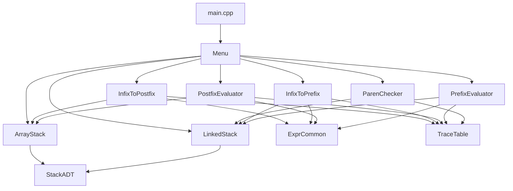

# PLAN — Expression Evaluator / Balanced-Parentheses Checker using Stack Operations

**Course:** Data Structures Lab, B.Tech CSE-AIML, Semester 3
**Institute:** Delhi Technical Campus (GGSIPU) — Section G, Group G1
**Faculty:** Akash Bhardwaj
**Team:** Aksh Rastogi (02518015625), Bhavya Porwal (02318015625)

---

## 1. Goal

A C++17 console menu application that shows the **Stack ADT**, written from scratch in two versions (array and linked list). The stack is used to:

1. Check balanced brackets `()`, `{}`, `[]` and report the type and position of any mismatch.
2. Convert infix to postfix and infix to prefix, with operator precedence and associativity.
3. Evaluate postfix and prefix expressions, with error handling (division by zero, invalid expressions).
4. Print a step-by-step **trace table** (`Symbol | Stack | Output/Action`) for every algorithm.

## 2. Constraints

| Constraint | Decision |
|---|---|
| Language | C++17 (`-std=c++17`). Only standard headers. **No `std::stack`.** |
| Compiler compatibility | Must build on **MinGW GCC 6.3** (the version on Aksh's laptop) and on Linux g++. GCC 6.3 accepts `-std=c++17` but does **not** have `<optional>`, `<variant>`, `<string_view>`, `<filesystem>`, structured bindings, `if constexpr`, or `if (init; cond)`. **Use only C++11/14 features in the code.** |
| Build | `Makefile` (run with `make` on Linux, `mingw32-make` on Windows) **and** a single `g++` command. |
| Containers allowed | `std::string`, `std::vector` (token lists only), `std::map` (variable values). The stacks themselves do **not** use STL containers. |
| Error handling | Stacks throw exceptions (`StackOverflowError`, `StackUnderflowError`). Algorithms do not throw: they return result structs with `ok` and `error` fields. |

## 3. Folder structure

```
DS PBL/
├── include/                 # all headers
│   ├── StackADT.h           # abstract stack interface + exception classes   [Aksh]
│   ├── ArrayStack.h         # template array-based stack (header-only)       [Aksh]
│   ├── LinkedStack.h        # template linked-list stack (header-only)       [Aksh]
│   ├── ExprCommon.h         # Token, result structs, tokenizer, helpers      [Aksh]
│   ├── TraceTable.h         # step-by-step table printer                     [Aksh]
│   ├── InfixToPostfix.h     #                                                [Aksh]
│   ├── PostfixEvaluator.h   #                                                [Aksh]
│   ├── Menu.h               #                                                [Aksh]
│   ├── ParenChecker.h       # signature fixed by plan                        [Bhavya implements]
│   ├── InfixToPrefix.h      # signature fixed by plan                        [Bhavya implements]
│   └── PrefixEvaluator.h    # signature fixed by plan                        [Bhavya implements]
├── src/
│   ├── main.cpp             # entry point → runMenu()                        [Aksh]
│   ├── Menu.cpp             # menu, input handling, integration              [Aksh]
│   ├── ExprCommon.cpp       # tokenizer, validator, precedence, applyOperator [Aksh]
│   ├── TraceTable.cpp       #                                                [Aksh]
│   ├── InfixToPostfix.cpp   #                                                [Aksh]
│   ├── PostfixEvaluator.cpp #                                                [Aksh]
│   ├── ParenChecker.cpp     #                                                [Bhavya]
│   ├── InfixToPrefix.cpp    #                                                [Bhavya]
│   └── PrefixEvaluator.cpp  #                                                [Bhavya]
├── tests/
│   └── test_main.cpp        # self-contained assertion test runner           [Bhavya]
├── docs/                    # Phase 3: report / PPT / poster / viva content
├── sample_inputs.txt        # demo inputs + expected outputs                 [Bhavya]
├── Makefile                 #                                                [Aksh]
├── README.md                #                                                [Aksh]
├── .gitignore               #                                                [Aksh]
├── PLAN.md / SPLIT.md / TEAMMATE_TASKS.md
```

**Plug-in rule:** In Phase 2 Aksh writes all headers, including Bhavya's three. Her three `.cpp` files start as stubs that print `not implemented yet`. Bhavya replaces **only** the bodies in `src/ParenChecker.cpp`, `src/InfixToPrefix.cpp`, `src/PrefixEvaluator.cpp`, and writes `tests/test_main.cpp` and `sample_inputs.txt`. **Nobody edits the other person's headers.** If a signature must change, both members agree first.

## 4. Module dependency graph



**Which stack each module uses** (so both versions are used in real work):
- Aksh's modules (infix→postfix, postfix evaluation) use `ArrayStack`.
- Bhavya's modules (bracket checker, infix→prefix, prefix evaluation) use `LinkedStack`.
- Menu option 7 lets the user try either stack directly, including overflow and underflow.

## 5. Exact header contents and signatures

These are **fixed**. Implementations must match them exactly.

### 5.1 `include/StackADT.h` (Aksh)

```cpp
#ifndef STACK_ADT_H
#define STACK_ADT_H
#include <stdexcept>
#include <string>

class StackOverflowError : public std::runtime_error {
public:
    explicit StackOverflowError(const std::string& msg) : std::runtime_error(msg) {}
};

class StackUnderflowError : public std::runtime_error {
public:
    explicit StackUnderflowError(const std::string& msg) : std::runtime_error(msg) {}
};

// Abstract interface implemented by ArrayStack<T> and LinkedStack<T>.
template <typename T>
class StackADT {
public:
    virtual ~StackADT() {}
    virtual void push(const T& value) = 0;      // throws StackOverflowError if full
    virtual T pop() = 0;                        // throws StackUnderflowError if empty
    virtual T peek() const = 0;                 // throws StackUnderflowError if empty
    virtual bool isEmpty() const = 0;
    virtual bool isFull() const = 0;
    virtual int size() const = 0;
    virtual void display() const = 0;           // prints "[bottom ... top]" to std::cout
    virtual std::string toString() const = 0;   // "a b c" bottom→top, space-separated ("" if empty)
};
#endif
```

### 5.2 `include/ArrayStack.h` (Aksh, header-only template)

```cpp
template <typename T>
class ArrayStack : public StackADT<T> {
public:
    explicit ArrayStack(int capacity = 100);     // capacity must be >= 1
    ~ArrayStack();
    ArrayStack(const ArrayStack&) = delete;      // no copying (owns raw array)
    ArrayStack& operator=(const ArrayStack&) = delete;

    void push(const T& value) override;
    T pop() override;
    T peek() const override;
    bool isEmpty() const override;
    bool isFull() const override;               // top == capacity - 1
    int size() const override;
    void display() const override;
    std::string toString() const override;
    int capacity() const;
private:
    T*  data_;      // new T[capacity]
    int capacity_;
    int top_;       // index of top element, -1 when empty
};
```

### 5.3 `include/LinkedStack.h` (Aksh, header-only template)

```cpp
template <typename T>
class LinkedStack : public StackADT<T> {
public:
    explicit LinkedStack(int maxSize = 0);      // 0 = unlimited (only limited by memory)
    ~LinkedStack();                             // frees every node
    LinkedStack(const LinkedStack&) = delete;
    LinkedStack& operator=(const LinkedStack&) = delete;

    void push(const T& value) override;         // overflow if maxSize reached or new fails
    T pop() override;
    T peek() const override;
    bool isEmpty() const override;
    bool isFull() const override;               // false when unlimited
    int size() const override;
    void display() const override;
    std::string toString() const override;
private:
    struct Node { T data; Node* next; };
    Node* head_;    // top of stack
    int   count_;
    int   maxSize_;
};
```

`toString()` and `display()` use `operator<<` on `T`, so any `T` stored must be printable with `<<`.

### 5.4 `include/ExprCommon.h` (Aksh): shared types and helpers

```cpp
#include <map>
#include <string>
#include <vector>

enum class TokenType { Number, Variable, Operator, LeftParen, RightParen };

struct Token {
    TokenType   type;
    std::string text;      // "12", "x", "+", "(", "]" ...
    int         position;  // 1-based column in the original input
};

struct TokenizeResult {
    bool               ok;
    std::vector<Token> tokens;
    std::string        error;   // e.g. "Invalid character '$' at position 4"
};

struct ConversionResult {
    bool        ok;
    std::string output;   // space-separated tokens, e.g. "a b c * +"
    std::string error;
};

struct EvalResult {
    bool        ok;
    double      value;
    std::string error;
};

typedef std::map<std::string, double> VarTable;   // variable name → value

// Splits an expression into tokens. Whitespace is skipped.
//   Number   : digits with at most one '.', e.g. 7, 123, 3.5
//   Variable : letter or '_' followed by letters/digits/'_', e.g. a, x1, total
//   Operator : + - * / % ^
//   Brackets : ( [ {  → LeftParen,   ) ] }  → RightParen
//   Anything else → ok=false, error names the character and its position.
TokenizeResult tokenize(const std::string& expr);

// Checks infix grammar: non-empty, operands and operators alternate,
// brackets nest and match by type, no empty "()", no unary operators.
// Returns "" when valid, otherwise a human-readable error message.
std::string validateInfix(const std::vector<Token>& tokens);

bool isOperator(const std::string& s);        // one of + - * / % ^
int  precedence(const std::string& op);       // ^ → 3,  * / % → 2,  + - → 1,  other → 0
bool isRightAssociative(const std::string& op); // true only for "^"
char matchingOpen(char close);                // ')'→'(', ']'→'[', '}'→'{', else '\0'
char matchingClose(char open);                // '('→')', '['→']', '{'→'}', else '\0'

// Applies a binary operator. Returns false and sets error on:
//   "Division by zero", "Modulo by zero",
//   "Modulo requires integer operands", "Result is not a finite number".
// % works on integer-valued doubles; ^ uses std::pow.
bool applyOperator(const std::string& op, double left, double right,
                   double& result, std::string& error);

// Unique variable names in order of first appearance, e.g. "a+b*a" → {"a","b"}.
std::vector<std::string> extractVariables(const std::string& expr);

// 12 → "12", 3.5 → "3.5", 0.333333... → "0.333333" (up to 6 significant digits).
std::string formatNumber(double value);

// Joins token texts with single spaces.
std::string joinTokens(const std::vector<std::string>& parts);
```

### 5.5 `include/TraceTable.h` (Aksh)

```cpp
class TraceTable {
public:
    TraceTable(const std::string& col1 = "Symbol",
               const std::string& col2 = "Stack",
               const std::string& col3 = "Output");
    void setHeaders(const std::string& col1, const std::string& col2, const std::string& col3);
    void addRow(const std::string& symbol, const std::string& stack, const std::string& output);
    void print() const;   // prints a boxed ASCII table to std::cout with auto column widths
    bool empty() const;
    void clear();         // removes rows, keeps headers
private:
    std::vector<std::string> headers_;          // size 3
    std::vector<std::vector<std::string> > rows_;
};
```

**Trace convention:** every algorithm takes `TraceTable* trace = nullptr`. If `trace != nullptr`, the algorithm calls `trace->setHeaders(...)` once and then `trace->addRow(...)` once per scanned symbol. It **never** prints the table itself. Menu.cpp prints it.

| Algorithm | Headers | Row content |
|---|---|---|
| Bracket checker | `Symbol`, `Stack`, `Action` | symbol + position e.g. `( @1`, stack bottom→top, `push` / `pop - matched` / `ERROR: ...` |
| Infix→postfix | `Symbol`, `Stack`, `Postfix` | token, operator stack, output so far. Final row symbol `(end)` |
| Infix→prefix | `Symbol`, `Stack`, `Output (reversed)` | token from the **reversed** scan, operator stack, output so far. Final row `(reverse)` with final prefix |
| Postfix eval / prefix eval | `Symbol`, `Stack`, `Action` | token, value stack after step, `push 5` or `3 * 4 = 12` or `ERROR: ...` |

### 5.6 `include/InfixToPostfix.h` (Aksh)

```cpp
// Tokenizes + validates infix, then converts with the operator-stack algorithm
// using ArrayStack<std::string>. Output tokens are space-separated.
ConversionResult infixToPostfix(const std::string& infix, TraceTable* trace = nullptr);
```

### 5.7 `include/PostfixEvaluator.h` (Aksh)

```cpp
// Evaluates space/operator-separated postfix using ArrayStack<double>.
// Variables are looked up in vars. Errors: empty input, invalid char,
// brackets present, undefined variable, insufficient operands,
// too many operands, and arithmetic errors from applyOperator.
EvalResult evaluatePostfix(const std::string& postfix, const VarTable& vars,
                           TraceTable* trace = nullptr);
```

### 5.8 `include/ParenChecker.h` (Bhavya implements)

```cpp
enum class ParenStatus { Balanced, UnexpectedClosing, MismatchedPair, UnclosedOpening };

struct ParenResult {
    bool        balanced;
    ParenStatus status;
    int         position;      // 1-based position of the offending bracket; -1 if balanced
    char        found;         // offending bracket character; '\0' if balanced
    char        expected;      // closing bracket that was expected; '\0' if none
    int         openPosition;  // position of the related opening bracket; -1 if none
    std::string message;       // full human-readable message
};

// Scans every character; only ( ) [ ] { } matter, everything else is ignored.
// Uses LinkedStack. Stops at the FIRST error.
ParenResult checkBalanced(const std::string& expr, TraceTable* trace = nullptr);
```

### 5.9 `include/InfixToPrefix.h` (Bhavya implements)

```cpp
// Tokenize + validateInfix (from ExprCommon), reverse tokens, swap brackets,
// run the operator-stack algorithm with LinkedStack<std::string>, then reverse output.
ConversionResult infixToPrefix(const std::string& infix, TraceTable* trace = nullptr);
```

### 5.10 `include/PrefixEvaluator.h` (Bhavya implements)

```cpp
// Scans prefix tokens right-to-left using LinkedStack<double>.
// First value popped = LEFT operand. Same errors as evaluatePostfix.
EvalResult evaluatePrefix(const std::string& prefix, const VarTable& vars,
                          TraceTable* trace = nullptr);
```

### 5.11 `include/Menu.h` (Aksh)

```cpp
void runMenu();   // main loop; returns when the user picks Exit
```

## 6. Menu design (Menu.cpp)

```
==========================================================
   EXPRESSION EVALUATOR & BALANCED-PARENTHESES CHECKER
          (Stack ADT - Array & Linked List)
==========================================================
 1. Check balanced brackets
 2. Convert infix  -> postfix
 3. Convert infix  -> prefix
 4. Evaluate postfix expression
 5. Evaluate prefix expression
 6. Full pipeline (infix -> postfix + prefix -> evaluate both)
 7. Stack ADT playground (array / linked list)
 8. Toggle trace mode            [currently: OFF]
 0. Exit
----------------------------------------------------------
Enter choice:
```

- Input is read with `std::getline` everywhere. Menu choices are validated (non-numeric or out of range → message and re-prompt). Empty expressions are rejected.
- Options 4, 5, 6: `extractVariables` finds variables, and the menu asks for the value of each one (validated as a number).
- Option 6 runs the bracket check, then both conversions, then evaluates both results and confirms they give the same value.
- Option 7 sub-menu: choose array or linked, enter capacity (linked: 0 = unlimited), then push / pop / peek / isEmpty / isFull / size / display / back on an `int` stack. Overflow and underflow exceptions are caught and shown. Both stacks are used through a `StackADT<int>*` pointer, which shows polymorphism.
- When trace mode is ON, each algorithm gets a `TraceTable` and the menu prints it before the result.

## 7. Algorithms (summary — full pseudocode in the Phase 3 report)

- **Bracket check:** for each char, push opening `{char, position}`. On closing: if the stack is empty → UnexpectedClosing. If the top does not match → MismatchedPair. Otherwise pop. At the end, a non-empty stack → UnclosedOpening (report the top).
- **Infix→postfix:** operand → output. `(` → push. `)` → pop to output until `(`. Operator `o` → while the top is an operator and (`prec(top) > prec(o)` or (`prec(top) == prec(o)` and `o` is left-assoc)), pop to output. Then push `o`. At the end, pop all.
- **Infix→prefix:** reverse the tokens and swap `(`↔`)`. Run the same loop, but pop while `prec(top) > prec(o)` or (`==` and `o` is **right**-assoc). Pop all, then reverse the output.
- **Postfix eval:** scan left→right. Operand → push. Operator → `right = pop`, `left = pop`, push `left op right`. At the end, exactly one value must remain.
- **Prefix eval:** scan right→left. Operand → push. Operator → `left = pop`, `right = pop`, push `left op right`. At the end, exactly one value must remain.

All are O(n) time and O(n) space.

## 8. Build steps

### Makefile (`make` on Linux, `mingw32-make` on Windows)

| Target | Effect |
|---|---|
| `all` (default) | builds `expr_eval` (`expr_eval.exe` on Windows) from all `src/*.cpp` |
| `test` | builds `test_runner` from `tests/test_main.cpp` + every `src/*.cpp` except `main.cpp` and `Menu.cpp`, then runs it |
| `run` | builds and runs `expr_eval` |
| `clean` | deletes binaries and object files (uses `del` on Windows, `rm -f` elsewhere) |

Flags: `-std=c++17 -Wall -Wextra -pedantic -Iinclude`.

### Single g++ command (same on Windows and Linux)

```bash
g++ -std=c++17 -Wall -Wextra -Iinclude src/main.cpp src/Menu.cpp src/ExprCommon.cpp src/TraceTable.cpp src/InfixToPostfix.cpp src/PostfixEvaluator.cpp src/ParenChecker.cpp src/InfixToPrefix.cpp src/PrefixEvaluator.cpp -o expr_eval
```

Tests:
```bash
g++ -std=c++17 -Wall -Wextra -Iinclude tests/test_main.cpp src/ExprCommon.cpp src/TraceTable.cpp src/InfixToPostfix.cpp src/PostfixEvaluator.cpp src/ParenChecker.cpp src/InfixToPrefix.cpp src/PrefixEvaluator.cpp -o test_runner
./test_runner        # Windows: test_runner.exe
```

## 9. Phases

| Phase | Content | Status |
|---|---|---|
| 1 | PLAN.md, SPLIT.md, TEAMMATE_TASKS.md | ← current |
| 2 | Aksh's 60%: stacks, ExprCommon, TraceTable, infix→postfix, postfix eval, menu, Makefile, README, .gitignore, **all headers**, stubs for Bhavya's 3 `.cpp` files + test stub. Commit list for Aksh to run by hand. | pending |
| 3 | After Bhavya merges: full build, run tests, fix integration, `docs/` (report, PPT, poster, viva Q&A, screenshot list) | pending |

## 10. Known limitations (by design, stated in README/report)

- No unary minus or plus (`-5`, `+x`). Write `(0-5)` instead. The validator rejects unary operators with a clear message.
- No functions (`sin`, `max`) and no assignment.
- Numbers are evaluated as `double`. `%` needs integer-valued operands.
