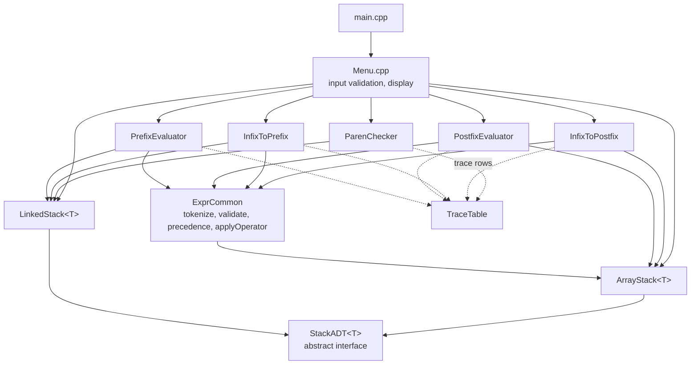
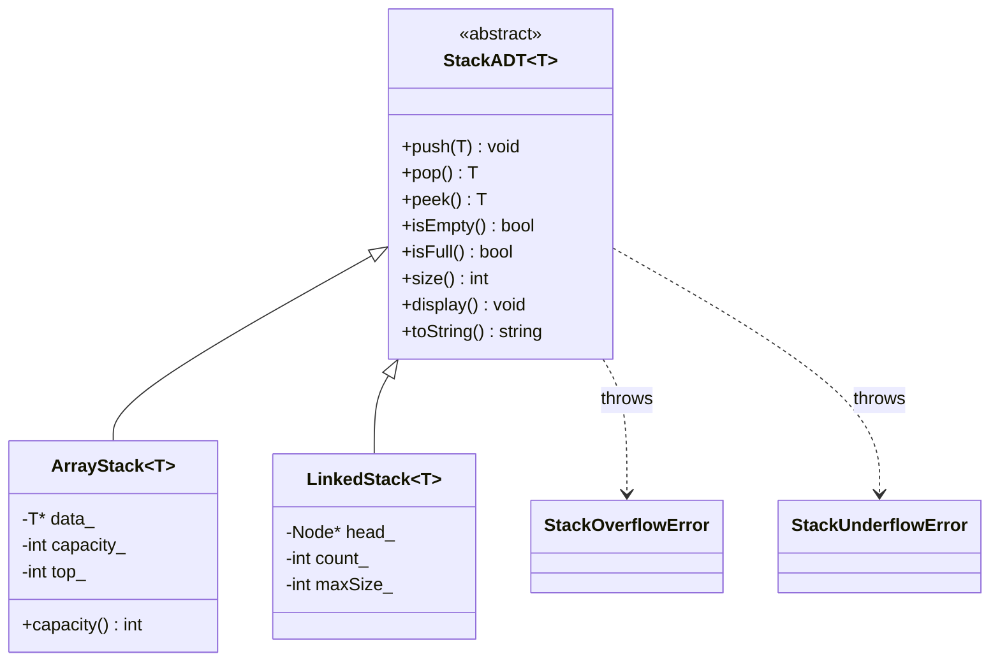
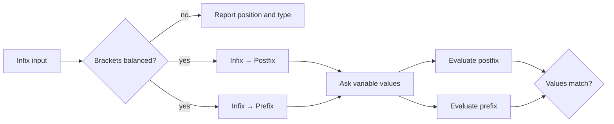

# Project Report Content

> Paste-ready content for the PBL report. Section numbers match a typical GGSIPU lab-report layout. Screenshots referenced as **[Fig. X]** are listed in `SCREENSHOTS_TODO.md`.

---

## Title Page

**EXPRESSION EVALUATOR / BALANCED-PARENTHESES CHECKER USING STACK OPERATIONS**

Project Based Learning (PBL) Report
Data Structures Lab

Submitted in partial fulfilment of the requirements for the degree of
**Bachelor of Technology**
in
**Computer Science and Engineering (Artificial Intelligence & Machine Learning)**

| | |
|---|---|
| **Submitted by** | Aksh Rastogi (02518015625) <br> Bhavya Porwal (02318015625) |
| **Section / Group** | G / G1 |
| **Semester** | 3 |
| **Submitted to** | Akash Bhardwaj |
| **Institute** | Delhi Technical Campus, Greater Noida (Affiliated to GGSIPU, New Delhi) |
| **Academic Year** | 2026–27 |
| **Source code** | https://github.com/ChickenWings-0/DS-PBL |

---

## Abstract

Stacks are the main data structure behind how compilers, interpreters and calculators process arithmetic expressions. This project builds a menu-driven C++17 console application around a **Stack Abstract Data Type written from scratch**, in two versions: a fixed-capacity **array-based stack** and a dynamic **linked-list-based stack**. Both follow one abstract interface and report overflow and underflow through exceptions. On top of this stack the application provides:

- a **balanced-brackets checker** for `()`, `{}` and `[]` that reports the exact position and type of any error
- **infix-to-postfix** and **infix-to-prefix** conversion that respects operator precedence and associativity, with multi-digit numbers and variables
- **postfix and prefix evaluation** with robust handling of division by zero and malformed expressions

A **trace mode** prints a step-by-step `Symbol | Stack | Output` table, so the user can see how the stack evolves. Each algorithm runs in O(n) time and O(n) space. Correctness was verified with an automated suite of **140 test checks**. These include a round-trip test confirming that the postfix and prefix forms of the same expression always evaluate to the same value.

**Keywords:** Stack ADT, LIFO, infix, postfix, prefix, Polish notation, shunting-yard, bracket matching, C++ templates.

---

## 1. Introduction

People write arithmetic in **infix** notation (`a + b * c`), where each operator sits between its operands. Infix is easy for humans but hard for machines: evaluating it correctly depends on precedence rules, associativity and brackets. Compilers therefore convert infix to **postfix** (Reverse Polish, `a b c * +`) or **prefix** (Polish, `+ a * b c`) notation. These forms need no brackets and can be evaluated in a single left-to-right or right-to-left scan.

Every one of these steps relies on the **stack**, a Last-In-First-Out (LIFO) structure:

- In bracket matching, the most recently opened bracket must be the first one closed.
- In conversion, an operator waits on the stack until an operator of lower precedence arrives.
- In evaluation, the two most recent operands are the ones an operator consumes.

This project implements the full pipeline (validation → bracket check → conversion → evaluation) in C++. The stack is written by hand rather than taken from the Standard Template Library, so both its internal design and its use in real algorithms can be shown.

## 2. Objectives

1. Design a generic **Stack ADT** and implement it in two versions (array and linked list) with `push`, `pop`, `peek`, `isEmpty`, `isFull`, `size` and `display`, including overflow/underflow handling.
2. Check whether an expression's brackets `()`, `{}`, `[]` are balanced, and report the **position** and **type** of any mismatch.
3. Convert infix expressions to **postfix** and **prefix** using operator precedence and associativity, with support for multi-digit numbers and variables.
4. **Evaluate** postfix and prefix expressions safely, detecting division by zero and invalid expressions.
5. Provide a **trace mode** that shows the stack's state at every step, as a learning aid.
6. Validate all user input and verify correctness with an automated test suite.

## 3. Theory

### 3.1 Stack

A stack is a linear data structure in which insertion (**push**) and deletion (**pop**) happen at one end only, called the **top**. The last element pushed is the first one popped (**LIFO**).

| Operation | Meaning | Error condition |
|---|---|---|
| `push(x)` | place `x` on top | **Overflow**: stack is full |
| `pop()` | remove and return the top | **Underflow**: stack is empty |
| `peek()` | return the top without removing it | Underflow |
| `isEmpty()` / `isFull()` | state checks | – |
| `size()` | number of elements | – |

**Array implementation:** elements are stored in `data[0 … capacity-1]`, and an integer `top` holds the index of the top element (`-1` when empty). The stack is full when `top == capacity - 1`.

**Linked-list implementation:** each element is a node `{data, next}`. `head` points to the top node, so push and pop only change the head pointer. The size is limited only by memory, or by an optional maximum chosen by the user.

### 3.2 Expression notations

| Notation | Operator position | Example (`(A+B)*C`) | Brackets needed? |
|---|---|---|---|
| Infix | between operands | `(A+B)*C` | yes |
| Postfix (Reverse Polish) | after operands | `A B + C *` | no |
| Prefix (Polish) | before operands | `* + A B C` | no |

**Precedence and associativity used:**

| Operator | Precedence | Associativity |
|---|---|---|
| `^` | 3 (highest) | right-to-left (`2^3^2 = 2^9 = 512`) |
| `*` `/` `%` | 2 | left-to-right |
| `+` `-` | 1 | left-to-right (`100-20-30 = 50`) |

### 3.3 Pseudocode

**Algorithm 1: Balanced-bracket check**
```
CHECK-BALANCED(expr)
    S ← empty stack
    for i ← 1 to length(expr)
        c ← expr[i]
        if c ∈ { '(', '[', '{' }
            PUSH(S, (c, i))
        else if c ∈ { ')', ']', '}' }
            if IS-EMPTY(S)
                return "Unexpected closing c at position i"
            (o, j) ← PEEK(S)
            if o is not the opening partner of c
                return "Mismatch at i: expected CLOSER(o) for o at j, found c"
            POP(S)
    if not IS-EMPTY(S)
        (o, j) ← PEEK(S)
        return "Unclosed o at position j"
    return "Balanced"
```

**Algorithm 2: Infix to postfix (operator-stack / shunting-yard)**
```
INFIX-TO-POSTFIX(tokens)
    S ← empty stack;  out ← empty list
    for each token t in tokens (left to right)
        if t is an operand:            append t to out
        else if t is an opening bracket: PUSH(S, t)
        else if t is a closing bracket:
            while TOP(S) is not an opening bracket: append POP(S) to out
            POP(S)                                   // discard the bracket
        else  // t is an operator
            while S not empty and TOP(S) is an operator and
                  ( prec(TOP(S)) > prec(t) or
                    (prec(TOP(S)) = prec(t) and t is left-associative) )
                append POP(S) to out
            PUSH(S, t)
    while S not empty: append POP(S) to out
    return out
```

**Algorithm 3: Infix to prefix (reverse → convert → reverse)**
```
INFIX-TO-PREFIX(tokens)
    R ← tokens reversed, with every '(' ↔ ')', '[' ↔ ']', '{' ↔ '}' swapped
    run INFIX-TO-POSTFIX on R, but pop on equal precedence only when
        t is RIGHT-associative            // the associativity rule flips
    return the output reversed
```

**Algorithm 4: Postfix evaluation**
```
EVAL-POSTFIX(tokens)
    S ← empty stack
    for each token t (left to right)
        if t is an operand: PUSH(S, value(t))
        else
            if SIZE(S) < 2: error "Insufficient operands"
            right ← POP(S);  left ← POP(S)
            if t ∈ {/, %} and right = 0: error "Division/Modulo by zero"
            PUSH(S, left t right)
    if SIZE(S) ≠ 1: error "Too many operands"
    return POP(S)
```

**Algorithm 5: Prefix evaluation**
```
EVAL-PREFIX(tokens)
    same as EVAL-POSTFIX, but scan tokens RIGHT to LEFT and
    left ← POP(S);  right ← POP(S)        // first pop is the LEFT operand
```

## 4. System Design

### 4.1 Architecture

The program has four layers:

1. **Data-structure layer**: `StackADT`, `ArrayStack`, `LinkedStack`
2. **Shared services**: tokenizer, validator, operator helpers, trace table
3. **Algorithm modules**: one module per feature
4. **Presentation layer**: the console menu

Algorithm modules never print anything. They return result structures, and the menu decides how to display them. This keeps every algorithm testable on its own.



### 4.2 Stack class design



### 4.3 Data flow of the full pipeline (menu option 6)



### 4.4 Folder structure

```
include/   headers (StackADT, ArrayStack, LinkedStack, ExprCommon, TraceTable, one per module, Menu)
src/       implementations + main.cpp
tests/     test_main.cpp (automated tests)
docs/      report, PPT, poster, viva content
Makefile   sample_inputs.txt   README.md
```

## 5. Implementation (module-wise)

**Language and tools:** C++17, only the standard library, and no `std::stack`. g++ (MinGW GCC 6.3 on Windows, GCC on Linux), GNU Make, Git/GitHub.

### 5.1 Stack ADT: `StackADT.h`, `ArrayStack.h`, `LinkedStack.h` (Owner: Aksh Rastogi)

- `StackADT<T>` is an abstract class template whose operations are all pure virtual functions. Two exception classes, `StackOverflowError` and `StackUnderflowError`, derive from `std::runtime_error`.
- `ArrayStack<T>` allocates `new T[capacity]` once and keeps a `top_` index. Every operation is O(1). Copying is disabled (`= delete`) so two objects can never free the same array.
- `LinkedStack<T>` keeps a pointer to the top node. `push` creates a node in front of `head_`, and `pop` unlinks and deletes it. The destructor frees every node. An optional `maxSize` lets overflow be demonstrated on a linked stack too, and a failed allocation (`std::bad_alloc`) is also reported as overflow.
- `toString()` returns the contents bottom→top and is used by the trace table. The linked version prepends each element while walking from the top.
- The menu's **Stack Playground** (option 7) drives either implementation through a `StackADT<int>*` pointer. This shows **runtime polymorphism**.

### 5.2 Tokenizer, validator and helpers: `ExprCommon` (Owner: Aksh Rastogi)

- `tokenize()` scans the input once and produces tokens of type Number (`12`, `3.5`), Variable (`x1`, `total`), Operator, LeftParen or RightParen, each with its 1-based position. Multi-digit numbers stay one token. Invalid characters and malformed numbers (`3.`, `1.2.3`) are rejected with their position.
- `validateInfix()` walks the tokens with an `expectOperand` flag and an `ArrayStack<int>` of open-bracket indices. It detects missing operands, missing operators, empty brackets, bracket mismatches, unclosed brackets and (unsupported) unary operators.
- `precedence()`, `isRightAssociative()`, `matchingOpen()` and `matchingClose()` hold the operator rules in one place.
- `applyOperator()` does the arithmetic **safely**. It returns an error instead of crashing on division by zero, modulo by zero, non-integer modulo, or non-finite results such as overflow.

### 5.3 Trace table: `TraceTable` (Owner: Aksh Rastogi)

Algorithms add rows of the form `(symbol, stack, output/action)`. `print()` sizes each column to its widest cell and draws a boxed ASCII table. When trace mode is off, the algorithms receive `nullptr` and skip all trace work.

### 5.4 Infix → postfix: `InfixToPostfix` (Owner: Aksh Rastogi)

The function tokenizes and validates the input, then runs Algorithm 2 with an `ArrayStack<std::string>`. The stack's capacity is set to the number of tokens, which guarantees it can never overflow. The output is space-separated, so multi-digit numbers stay unambiguous.

### 5.5 Postfix evaluation: `PostfixEvaluator` (Owner: Aksh Rastogi)

Algorithm 4 runs with an `ArrayStack<double>`. Variables are looked up in a `std::map` filled by the menu. The errors it reports are empty input, brackets present, undefined variable, insufficient operands, too many operands, and the arithmetic errors from `applyOperator`. Each error message includes the token position.

### 5.6 Balanced-bracket checker: `ParenChecker` (Owner: Bhavya Porwal)

Algorithm 1 runs with a `LinkedStack<OpenBracket>`, where `OpenBracket = {symbol, position}`. Storing the position lets the checker say exactly which opening bracket is unmatched. It returns a `ParenResult` with the status (`Balanced`, `UnexpectedClosing`, `MismatchedPair` or `UnclosedOpening`), the offending position, the found and expected characters, and a full message. The menu prints a caret `^` under the error position.

### 5.7 Infix → prefix: `InfixToPrefix` (Owner: Bhavya Porwal)

Algorithm 3 runs with a `LinkedStack<std::string>`. The **token vector** is reversed, not the character string, so `12` never becomes `21`. Bracket types are swapped, and the associativity condition is flipped: equal-precedence operators are popped only for right-associative `^`. This flip makes `100-20-30` become `- - 100 20 30` and `2^3^2` become `^ 2 ^ 3 2`.

### 5.8 Prefix evaluation: `PrefixEvaluator` (Owner: Bhavya Porwal)

Algorithm 5 runs with a `LinkedStack<double>`, scanning right-to-left. The **first** value popped is the **left** operand, which is the opposite of postfix. It reports the same set of errors as the postfix evaluator.

### 5.9 Menu and integration: `Menu.cpp`, `main.cpp` (Owner: Aksh Rastogi)

The menu has eight options plus Exit:

| Option | Action |
|---|---|
| 1 | Check brackets |
| 2 | Infix → postfix |
| 3 | Infix → prefix |
| 4 | Evaluate postfix |
| 5 | Evaluate prefix |
| 6 | Full pipeline |
| 7 | Stack playground |
| 8 | Toggle trace mode |
| 0 | Exit |

All input is read with `std::getline` and validated. Menu choices are range-checked, empty expressions are re-prompted, variable values must be finite numbers, and end-of-input exits cleanly.

### 5.10 Test suite and sample inputs (Owner: Bhavya Porwal)

`tests/test_main.cpp` is a dependency-free test runner with 140 checks in 9 groups (see §8). `sample_inputs.txt` lists demo inputs with their expected outputs.

### 5.11 Build system (Owner: Aksh Rastogi)

The `Makefile` has the targets `all`, `run`, `test` and `clean`, and detects Windows (`cmd.exe`, `.exe`, `del`) versus Linux. The project can also be built with one `g++` command (see README).

## 6. Contribution Table

| Member | Modules / files | Lines | Share |
|---|---|---|---|
| **Aksh Rastogi** (02518015625) | StackADT, ArrayStack, LinkedStack, ExprCommon (tokenizer + validator), TraceTable, InfixToPostfix, PostfixEvaluator, Menu + main, all 11 headers, Makefile | 1,467 | **≈ 62%** |
| **Bhavya Porwal** (02318015625) | ParenChecker, InfixToPrefix, PrefixEvaluator (`.cpp`), test suite (140 checks), sample inputs | 913 | **≈ 38%** |
| Both | Planning, integration testing, report, PPT, poster | – | – |

*Lines are counted with `wc -l` and include comments and blank lines. README is not counted.*

## 7. Complexity Analysis

*n* = number of characters (bracket check) or tokens (all other algorithms).

| Operation / algorithm | Time | Extra space | Stack used |
|---|---|---|---|
| `push`, `pop`, `peek`, `isEmpty`, `isFull`, `size` | O(1) | O(1) | both |
| `display`, `toString` | O(n) (array) / O(n²) worst case for string prepending (linked) | O(n) | both |
| Tokenize | O(n) | O(n) | – |
| Validate infix | O(n) | O(n) | ArrayStack |
| Balanced-bracket check | O(n) | O(n) | LinkedStack |
| Infix → postfix | O(n) | O(n) | ArrayStack |
| Infix → prefix | O(n) | O(n) | LinkedStack |
| Postfix evaluation | O(n) | O(n) | ArrayStack |
| Prefix evaluation | O(n) | O(n) | LinkedStack |

Each token is pushed at most once and popped at most once, so every algorithm is linear.

**Array vs linked list:**

| | ArrayStack | LinkedStack |
|---|---|---|
| Memory | one contiguous block, fixed at creation | one node per element, plus one pointer each |
| Overflow | when `top == capacity - 1` | only at the optional limit or when memory runs out |
| Cache behaviour | better (contiguous) | worse (scattered nodes) |
| Best for | known maximum size | unknown or varying size |

## 8. Testing

### 8.1 Automated test suite (`mingw32-make test` / `make test`)

| # | Test group | Checks | What is verified | Result |
|---|---|---|---|---|
| 1 | ArrayStack | 14 | empty/full state, LIFO order, `toString`, overflow and underflow exceptions | Pass |
| 2 | LinkedStack | 10 | bounded overflow, unlimited 1000 pushes, order, underflow on pop/peek | Pass |
| 3 | Tokenizer | 9 | multi-digit, decimal, variable tokens with positions; invalid character | Pass |
| 4 | Bracket checker | 27 | all four statuses, positions, found/expected chars, exact messages | Pass |
| 5 | Infix → postfix | 12 | precedence, `^` right-assoc, left-assoc `-`, mixed brackets, invalid inputs | Pass |
| 6 | Infix → prefix | 11 | same cases in prefix form, invalid inputs | Pass |
| 7 | Postfix evaluation | 10 | values, variables, division by zero, operand-count errors | Pass |
| 8 | Prefix evaluation | 17 | operand order (`- 10 4 = 6`), all operators, all error messages | Pass |
| 9 | Round-trip | 30 | eval(postfix(x)) = eval(prefix(x)) for 6 expressions | Pass |
| | **Total** | **140** | | **140 / 140 pass** |

### 8.2 Manual test cases (menu)

| ID | Option | Input | Expected | Actual |
|---|---|---|---|---|
| T1 | 1 | `{[a+b]*(c-d)}` | Balanced | Balanced ✔ |
| T2 | 1 | `{a+(b*c})` | Mismatch at 8: found `}` expected `)` (open at 4) | ✔ |
| T3 | 1 | `a+b)` | Unexpected closing `)` at 4 | ✔ |
| T4 | 1 | `((a+b)` | Unclosed `(` at 1 | ✔ |
| T5 | 2 | `a+b*(c^d-e)^(f+g*h)-i` | `a b c d ^ e - f g h * + ^ * + i -` | ✔ |
| T6 | 2 | `2^3^2` | `2 3 2 ^ ^` | ✔ |
| T7 | 3 | `100-20-30` | `- - 100 20 30` | ✔ |
| T8 | 3 | `(12+8)*3/4` | `/ * + 12 8 3 4` | ✔ |
| T9 | 4 | `5 1 2 + 4 * + 3 -` | 14 | ✔ |
| T10 | 4 | `5 0 /` | Division by zero at position 5 | ✔ |
| T11 | 5 | `- 10 4` | 6 | ✔ |
| T12 | 5 | `+ 2 3 4` | Too many operands: 2 values left | ✔ |
| T13 | 6 | `a+b*(c-d)/e`, a=10 b=4 c=9 d=3 e=2 | both 22, MATCH | ✔ |
| T14 | 2 | `a+*b` | operator missing left operand (pos 3) | ✔ |
| T15 | 2 | `-5+2` | unary minus not supported | ✔ |
| T16 | 7 | ArrayStack cap 2, push ×3 | third push → OVERFLOW | ✔ |
| T17 | 7 | LinkedStack, pop on empty | UNDERFLOW | ✔ |
| T18 | menu | `abc`, `9`, empty | re-prompt with message | ✔ |

## 9. Sample Input / Output

**Infix → postfix with trace** (`(A+B)*C`) **[Fig. 3]**
```
+--------+-------+-----------+
| Symbol | Stack | Postfix   |
+--------+-------+-----------+
| (      | (     |           |
| A      | (     | A         |
| +      | ( +   | A         |
| B      | ( +   | A B       |
| )      |       | A B +     |
| *      | *     | A B +     |
| C      | *     | A B + C   |
| (end)  |       | A B + C * |
+--------+-------+-----------+
  Postfix: A B + C *
```

**Bracket mismatch** (`{a+(b*c})`) **[Fig. 2]**
```
+--------+-------+-----------------------------------+
| Symbol | Stack | Action                            |
+--------+-------+-----------------------------------+
| { @1   | {     | push                              |
| ( @4   | { (   | push                              |
| } @8   | { (   | ERROR: expected ')' but found '}' |
+--------+-------+-----------------------------------+
  Result: [ERROR] Mismatch at position 8: found '}' but expected ')' to close '(' from position 4.
    {a+(b*c})
           ^
```

**Prefix evaluation with trace** (`* + 2 3 4`) **[Fig. 5]**
```
+--------+-------+------------+
| Symbol | Stack | Action     |
+--------+-------+------------+
| 4      | 4     | push 4     |
| 3      | 4 3   | push 3     |
| 2      | 4 3 2 | push 2     |
| +      | 4 5   | 2 + 3 = 5  |
| *      | 20    | 5 * 4 = 20 |
+--------+-------+------------+
  Result = 20
```

**Full pipeline** (`a+b*(c-d)/e`) **[Fig. 6]**
```
  Step 1  Brackets : Balanced: all brackets are properly matched.
  Step 2  Postfix  : a b c d - * e / +
  Step 3  Prefix   : + a / * b - c d e
  Step 4  Values   : a=10 b=4 c=9 d=3 e=2
  Step 5a Postfix value: 22
  Step 5b Prefix value : 22
  Check: postfix and prefix results MATCH
```

**Error handling** **[Fig. 7]**
```
  [ERROR] Division by zero at position 5
  [ERROR] Operator '*' at position 3 is missing its left operand
  [OVERFLOW] Stack overflow: array stack is full (capacity 2)
  [UNDERFLOW] Stack underflow: cannot pop from an empty stack
```

## 10. Known Limitations

- **No unary operators.** `-5` and `+x` are rejected with the message `Unary '-' at position 1 is not supported; write (0-x) instead`.
- **No functions or constants.** `sin`, `max` and `pi` are not supported. An identifier is always treated as a variable.
- **No assignment or memory.** Variable values are asked for on each evaluation and are not kept between runs.
- **Floating-point arithmetic.** Values are `double` (about 15 significant digits), and results are shown with up to 6 significant digits. `%` needs whole-number operands.
- **Space-separated postfix/prefix input.** Operands in postfix and prefix input must be separated by spaces (`12 8 +`, not `128+`), because adjacent digits form one number.
- **The first error only.** Validation and the bracket checker report the first error they find, not every error in the expression.
- **Console interface only.** There is no graphical display of the stack.

## 11. Conclusion

The project shows how one simple data structure, the stack, solves several related problems in expression processing:

- matching brackets with exact error reporting
- converting infix to postfix and prefix while respecting precedence and associativity
- evaluating both forms safely

Writing the stack ourselves in array and linked-list versions, behind one abstract interface, showed the trade-offs between contiguous and linked storage and the value of polymorphism and templates. Every algorithm runs in linear time. The trace mode makes the stack's behaviour visible step by step. An automated test suite of 140 checks, including postfix-vs-prefix round-trip tests, gives strong confidence that the implementation is correct.

## 12. Future Scope

- Support **unary operators** (`-5`, `+x`) by detecting them in the tokenizer and giving them their own precedence.
- Support **functions** (`sin`, `max`, `sqrt`) and **constants** (`pi`, `e`).
- Build an **expression tree** from the postfix form and use it to derive the infix, prefix and postfix forms and to draw the tree.
- **Assignment and variable memory** (`x = 5; y = x*2`) to turn the program into a small interpreter.
- A **graphical or web front-end** that animates the stack.
- **Big-number / exact-fraction arithmetic** in place of `double`.
- Batch mode that reads expressions from a file and writes results to a report.

## 13. References

1. T. H. Cormen, C. E. Leiserson, R. L. Rivest, C. Stein, *Introduction to Algorithms*, 3rd ed., MIT Press, 2009. Ch. 10.1 "Stacks and queues".
2. M. A. Weiss, *Data Structures and Algorithm Analysis in C++*, 4th ed., Pearson, 2014. Ch. 3 "Lists, Stacks, and Queues".
3. E. Horowitz, S. Sahni, D. Mehta, *Fundamentals of Data Structures in C++*, 2nd ed., Silicon Press, 2006. Ch. 3 "Stacks and Queues" (evaluation of expressions).
4. E. W. Dijkstra, "ALGOL 60 translation: An ALGOL 60 translator for the X1", Mathematisch Centrum, Amsterdam, Report MR 35, 1961 (origin of the shunting-yard algorithm).
5. B. Stroustrup, *The C++ Programming Language*, 4th ed., Addison-Wesley, 2013.
6. cppreference.com, C++ Standard Library reference, https://en.cppreference.com
7. Project repository: https://github.com/ChickenWings-0/DS-PBL
